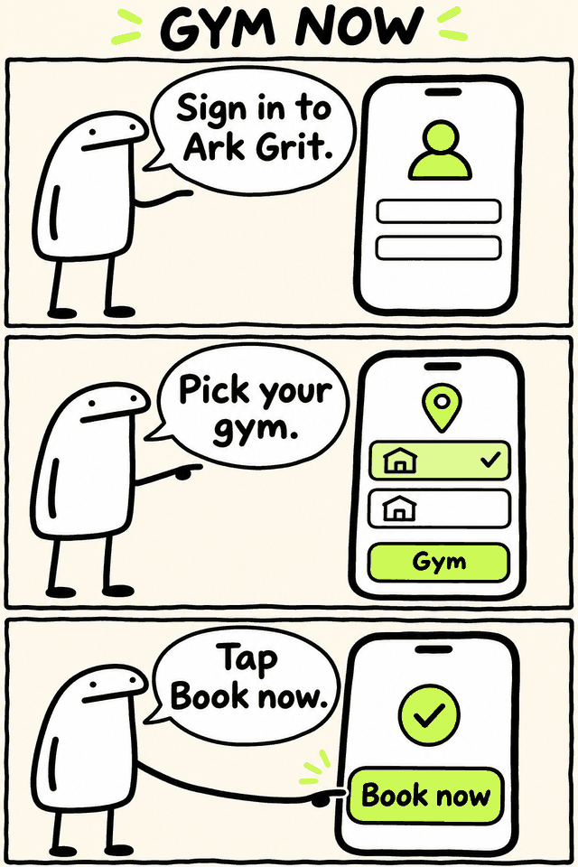

# Gym Now

**Save time with one-click booking for Ark Grit gyms.** Gym Now reuses your current booking or books the current slot, then opens Ark’s entry page.

[**Download APK v0.3.2**](https://github.com/capmeowstr/GymNow/releases/download/v0.3.2/Gym_Now_v0_3_2.apk) · [Release notes](https://github.com/capmeowstr/GymNow/releases/tag/v0.3.2)

Unofficial app for Android 8.0+ · Ark Grit account and eligible gym subscription required

## Quick start

[Open the full-size comic](./docs/gym-now-quick-start.png) · [Written steps](./docs/guide.md#first-launch)

[Install and update](./docs/guide.md#install-the-apk) · [Build from source](./docs/guide.md#build-from-source) · [Privacy](./docs/guide.md#credential-storage-and-privacy) · [MIT license for the code](./LICENSE)
