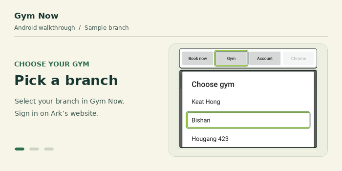

# Gym Now

**Book your current Ark Grit gym slot in one tap.** Gym Now checks for an existing booking first, then opens Ark’s entry page.

[**Download APK v0.3.2**](https://github.com/capmeowstr/GymNow/releases/download/v0.3.2/Gym_Now_v0_3_2.apk) · [Release notes](https://github.com/capmeowstr/GymNow/releases/tag/v0.3.2) · [Setup guide](docs/guide.md#first-launch)

Android 8.0+ · Ark Grit account and eligible subscription required · Unofficial

*The walkthrough uses screenshots from a clean Android emulator. The final entry step is illustrated.*

## Features

- **One-tap booking.** Reuse your current booking or reserve the current slot at your chosen branch.
- **Entry shortcut.** Open Ark’s Remote Entry and tap **Unlock** when you reach the door.
- **Stay signed in.** Use the existing website session or opt in to saving your Ark login on the device.

## Quick start

[Install and update](docs/guide.md#install-the-apk) · [Build from source](docs/guide.md#build-from-source) · [Privacy](docs/guide.md#credential-storage-and-privacy) · [MIT license](LICENSE)
